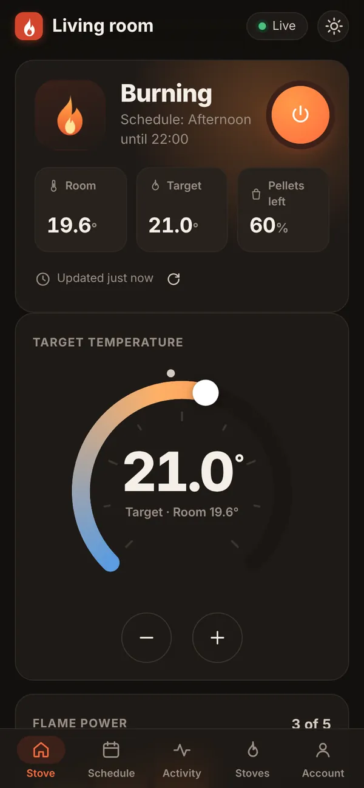
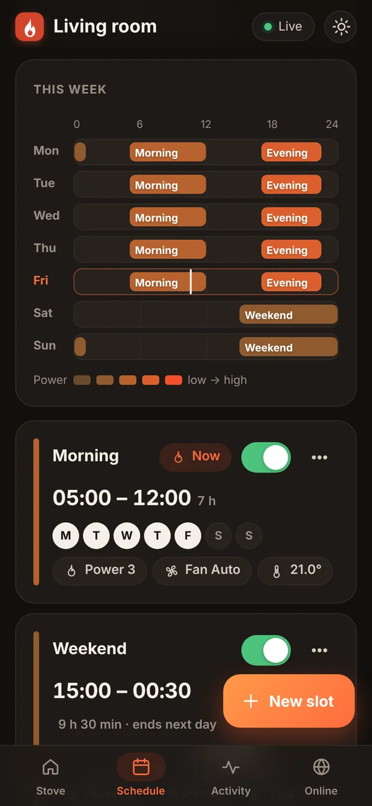
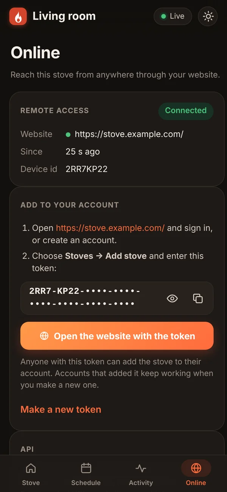
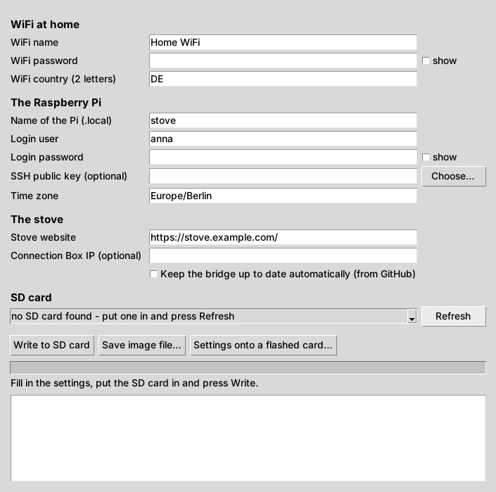
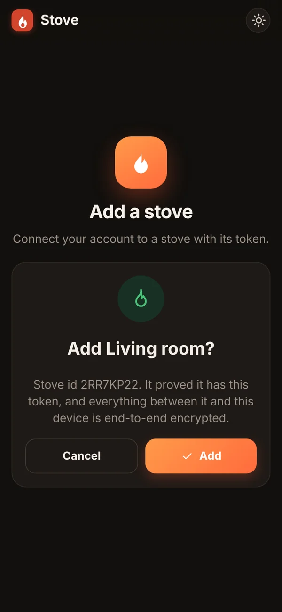
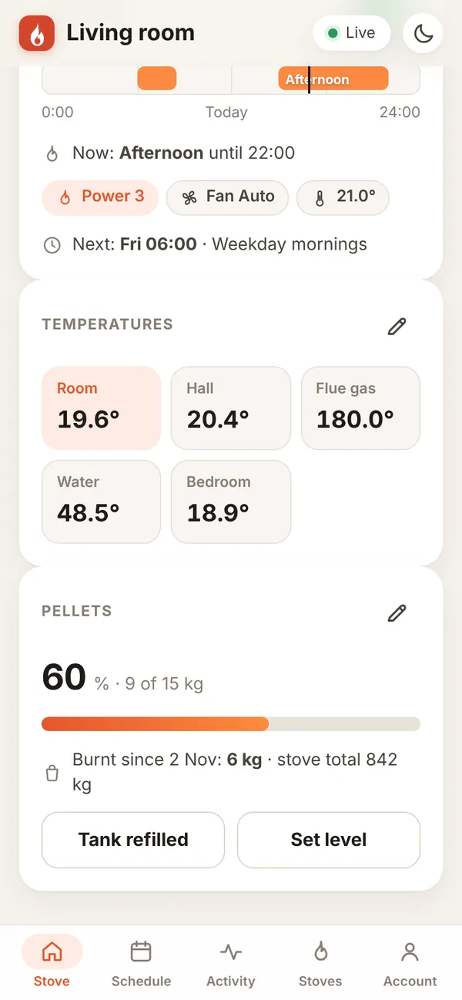
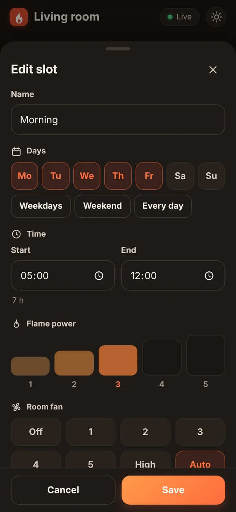
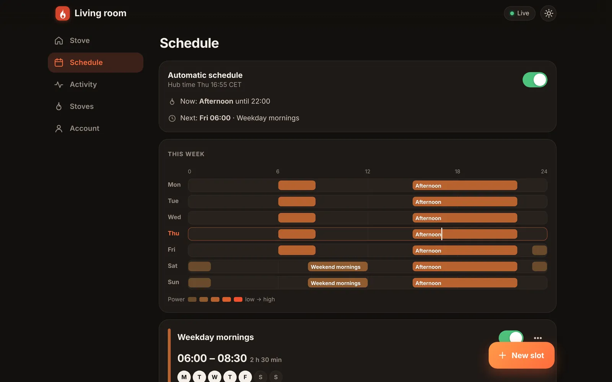

# Palazzetti Stove Hub

Control a Palazzetti pellet stove from Python, from a phone at home (**http://stove.local**, no
password needed) and from anywhere (through a website of your own, e.g.
**https://example.com/mystove/**, with accounts), with a weekly schedule where every slot has its
own power, fan level and temperature, and with push notifications on iPhone and Android. A
Raspberry Pi next to the stove does the work: it talks to the stove's Connection Box on the home
network, runs the schedule and serves the app.

Everything between your phone and the stove is **end-to-end encrypted**: the website on the VPS
only passes sealed messages between your browser and the Raspberry Pi at home. Plain Python 3
(standard library, plus the `cryptography` package for the encryption), no build step, no cloud
account — neither the manufacturer's nor anybody else's.

> **Not affiliated with Palazzetti.** This is an independent project, not made, endorsed or
> supported by Palazzetti. "Palazzetti" is a trademark of its owner and is used here only to say
> which stoves the software works with. It switches a heating appliance on and off, also while
> nobody is at home: **use it at your own risk**. It does not replace the stove's own safety
> devices, its maintenance or a smoke and CO alarm, and it comes without any warranty (see
> [LICENSE](LICENSE)).

<p align="center">
  &nbsp;
  &nbsp;
  
</p>

```
 at home                                                                         Palazzetti
 ┌──────────────┐ http://stove.local  ┌──────────────────────────┐   HTTP   ┌───────────────┐ serial ┌───────┐
 │ phone / PC   │ ──────────────────▶ │ Raspberry Pi Zero W      │ ───────▶ │ Connection Box│ ─────▶ │ stove │
 └──────────────┘ ws:// (no login,    │ stove_master.py          │          └───────────────┘        └───────┘
                  home network only)  │ dashboard · scheduler ·  │
                                      │ mDNS · SQLite            │
                                      └────────────┬─────────────┘
                                                   │ wss:// always-on WebSocket (outbound,
 anywhere                                          │ no port forwarding at home)
 ┌──────────────┐ https://example.com/mystove/     ▼
 │ phone / PC   │ ────────────────────▶ nginx ──▶ stove_cloud.py (VPS: accounts, app files,
 └──────────────┘ https: app + accounts           relay of end-to-end encrypted messages,
                  wss:   stove commands and data  push notifications)
```

## What you need

* A Palazzetti pellet stove with a **Connection Box** — the small Wi-Fi/Ethernet bridge on the
  stove's serial port ([below](#how-the-connection-box-is-controlled)) — on your home network.
* A **Raspberry Pi** on the same network, with Raspberry Pi OS; a Pi Zero W is enough. (Or Docker
  on a computer that is always on: [the hub in Docker](#the-hub-in-docker-on-your-pc).)
* Optional, for remote access and push notifications: a **VPS** (any small Linux server with
  systemd) and a domain that nginx already serves over HTTPS. Nothing is opened on the home
  router: the Pi connects out to it.

## Quick start

On the Raspberry Pi:

```bash
sudo apt install -y git
git clone https://github.com/AlesZupanc/palazzetti-stove-hub.git
cd palazzetti-stove-hub
sudo pi/install.sh          # finds the Connection Box, asks for the name (stove.local) and the website
```

Then open **http://stove.local/** on a phone or PC at home. Other ways in:

* **No Pi set up yet?** `python3 pi/stove-sd.py` on your PC makes an SD card that sets the Pi up
  by itself ([Ready-made SD card](#ready-made-sd-card-wifi-and-the-bridge-preset)).
* **No stove at hand?** `docker compose up -d --build` runs the hub with a simulated stove on
  `http://localhost:8080/` ([Docker](#the-hub-in-docker-on-your-pc)).
* **From anywhere:** install the website on your VPS (`sudo www/deploy.sh`,
  [The website on the VPS](#the-website-on-the-vps-www)), enter its address in the Pi's setup and
  add the stove to your account with its token ([Connect the Pi](#connect-the-pi-and-add-the-stove)).
* **Updates:** `git pull && sudo pi/install.sh`, or by themselves with
  `sudo pi/install.sh --auto-update`, which follows the tested `deploy` branch of the repository
  you cloned. To decide yourself what reaches your stove, clone your own fork
  ([Automatic updates](#automatic-updates)).

MIT licence, see [LICENSE](LICENSE). Found a security problem? Please report it privately:
[SECURITY.md](SECURITY.md).

## Contents

* [How it fits together](#how-it-fits-together) · [What is in this repository](#what-is-in-this-repository)
* [How the Connection Box is controlled](#how-the-connection-box-is-controlled)
* [The original scripts](#the-original-scripts): `palazzetti.py`, `stove_web.py`, `cbox_probe.py`
* [The stove master on the Raspberry Pi](#the-stove-master-on-the-raspberry-pi)
  * [Ready-made SD card](#ready-made-sd-card-wifi-and-the-bridge-preset) · [Install](#install-on-the-raspberry-pi) ·
    [stove.local](#stovelocal-mdns) · [The local dashboard](#the-local-dashboard-no-login) ·
    [Local API](#local-api-plain-urls-eg-for-siri) · [Weekly scheduler](#weekly-scheduler) ·
    [Configuration](#configuration-of-the-pi) · [Behind your own reverse proxy](#behind-your-own-reverse-proxy) ·
    [Command line](#command-line-of-the-pi)
* [The website on the VPS](#the-website-on-the-vps-www)
  * [Deploy](#deploy-on-the-vps) · [Automatic updates](#automatic-updates) · [What changes in nginx](#what-deploysh-does-to-nginx) ·
    [Accounts](#accounts-administrators-and-e-mail) · [E-mail (own mail server)](#e-mail) ·
    [Add your stove](#connect-the-pi-and-add-the-stove) · [Configuration](#configuration-of-the-website) ·
    [Command line](#command-line-of-the-website)
* [The app: screens, install, notifications](#the-app-screens-install-notifications)
* [Security](#security) · [Troubleshooting](#troubleshooting) · [Development and tests](#development-and-tests) ·
  [Docker](#the-hub-in-docker-on-your-pc) · [Licence](#licence)

---

## How it fits together

* **At home** the Raspberry Pi serves the **local dashboard** on `http://stove.local/`. It has no
  login — a password over plain `http://` would protect nothing — but it only answers devices on
  the home network. Its pages talk to the Pi over a WebSocket (`ws://`), and the Pi pushes the
  stove's status every few seconds, so every open phone shows the same thing at once.
* **The Pi keeps one WebSocket open to the website** on your VPS (`wss://`, outbound, so nothing
  is opened on the home router).
* **The website** (`www/`, on your VPS, e.g. at `https://example.com/mystove/`) serves the same
  app over HTTPS and holds the **accounts**. New accounts need the administrator's approval by
  e-mail.
* **Adding your stove to your account**: the local dashboard shows the Pi's **token**, unique for
  every Pi. You enter it on the website (or just tap the link the dashboard offers) and confirm
  "Add". The token never reaches the server: the browser and the Pi use it to prove to each other
  that they know it, and from then on talk **end-to-end encrypted** — the website only forwards
  sealed messages (commands and telemetry) between the two.
* **Your stoves follow your account**: the list of stoves with their keys is stored on the website
  encrypted with a key derived from your password, which never leaves your browser. Sign in on a
  new phone and the stoves are there; the server still cannot open them.
* **The app installs** to the home screen (a PWA) and sends **push notifications** — alarms, a
  stove that did not light, the hub going offline, and if you like the schedule switching the
  stove on and off — on Android, on iPhone/iPad (iOS 16.4+, app added to the home screen) and on
  desktop browsers. The Pi encrypts each notification for your phone; the website and the push
  service (Google, Apple, …) only see ciphertext.

The protocols in detail: [docs/protocol.md](docs/protocol.md).

## What is in this repository

```
palazzetti.py          library + command line tool for the Connection Box (discover, status, on/off, ...)
stove_web.py           the first, minimal web page for the LAN
cbox_probe.py          read-only probe of the Connection Box web UI and network/cloud settings

stove_master.py        the hub on the Raspberry Pi: serve, setup wizard, token, links, schedule
stovemaster/           its implementation
  api.py                 the API (JSON RPC), status telemetry, alarm detection
  lan.py                 the local dashboard's web server: app files and ws:// /ws, home network only
  cloud.py               the always-on WebSocket to the website, encrypted sessions, linked accounts, push
  e2e.py                 the stove's token and the end-to-end encryption (P-256, HKDF, AES-GCM)
  webpush.py             push notification encryption (RFC 8291)
  ws.py                  WebSocket protocol (RFC 6455), server and client
  scheduler.py           the weekly scheduler
  stove.py               thread-safe stove access (one command at a time, cached status, optimistic UI)
  mdns.py                mDNS responder that publishes stove.local (+ DNS-SD _http._tcp)
  db.py, config.py       SQLite (schedule, settings, activity, links, push) and stove.ini
pi/
  install.sh             installer/updater for Raspberry Pi OS
  stove-sd.py            app for your PC: makes and writes the Pi's SD card
  make-image.py          the same from the command line
  stove-master.service   systemd unit (port 80 without root, hardened)
  stove.ini.example      every setting with its default and an explanation

www/                   the website - upload this folder to the VPS
  deploy.sh              nginx-aware installer (keeps your existing routing)
  mail-server.sh         optional: send the website's e-mail from the VPS itself (Postfix + DKIM)
  mail_dns.py            its DNS checks: SPF, DKIM, DMARC, reverse DNS, port 25
  stove_cloud.py         the website: serve, config, administrator, accounts, devices
  stovecloud/            its implementation: accounts, encrypted vault, relay hub, push (VAPID), web
  app/                   THE web app, used by the website and by the Pi (copied there by install.sh)
                         app.js, link.js, crypto.js, home.js, schedule.js, pages.js, local.js,
                         cloud.js, push.js, sw.js (service worker), app.css, icons, manifest
  nginx_patch.py         finds the right nginx server block and adds/removes one include line
  nginx-stove-cloud.conf.in   the nginx snippet (location /mystove/ incl. WebSockets)
  stove-cloud.service.in      systemd unit of the website
  README.md              short version of the VPS part of this file

docs/protocol.md       how browser, Pi and website talk (RPC, encryption, accounts, push)
docs/screenshots/      the pictures in this file
tools/fake_cbox.py     Connection Box simulator for development
tools/stove_local.py   answers stove.local on your PC for the hub in Docker (Windows, macOS)
tools/auto-update.sh   follows the tested "deploy" branch: systemd timer for the VPS and the Pi (--auto-update)
tools/make-shortcuts.py  Siri shortcuts (.shortcut files) with your token: "Control the stove", "Stove on", ...
.github/workflows/     CI: the tests on every push; main -> deploy when they pass
.github/dependabot.yml pull requests for new releases of the actions and of tests/requirements.txt
docker/                the hub in a container, laid out as on the Pi; Dockerfile also builds the fake box
compose.yaml           docker compose up -> hub on http://localhost:8080/ with the simulated stove
tests/                 unit and end-to-end tests (python3 -m unittest discover -s tests)
  requirements.txt       what CI installs for them: cryptography, pinned with hashes
LICENSE                MIT licence
SECURITY.md            how to report a security problem
```

---

## How the Connection Box is controlled

The Palazzetti Connection Box is a small Wi-Fi/Ethernet bridge connected to the stove's serial
(COM) port. It has a local HTTP API, so nothing here needs the Palazzetti cloud.

**Discovery.** A UDP broadcast of the text `plzbridge?` to port **54549** makes every box on the
network answer with a JSON description. If broadcasts are blocked, `palazzetti.py` falls back to
probing every host of the local /24 network over HTTP and looks for the box's web UI (it redirects
to `./cgi-bin/`).

**Commands.** Every stove command is an HTTP GET:

```
http://<box>/cgi-bin/sendmsg.lua?cmd=<COMMAND>
→ {"INFO": {"CMD": "...", "RSP": "OK"}, "SUCCESS": true, "DATA": {...}}
```

| Command | Meaning |
|---|---|
| `GET ALLS` | everything at once: `STATUS`, `SETP` (setpoint), `PWR` (power), `F2L` (room fan), `T1`–`T5` (temperatures), `PQT` (pellets used, kg), ... |
| `GET STDT` | static data: label, MAC, firmware, stove type |
| `CMD ON` / `CMD OFF` | switch the stove on / off |
| `SET SETP 21.5` | target temperature (°C; older firmware accepts whole degrees only) |
| `SET POWR 3` | power level 1–5 |
| `SET RFAN 7` | room fan: 0 = off, 1–5, 6 = high, 7 = auto (model dependent) |

The box answers `"RSP": "TIMEOUT"` when the stove does not reply on the serial link in time; that
is usually transient and is retried twice. `cgi-bin/syscmd.lua?cmd=netdata` is answered by the box
itself (network data, label, firmware, whether it reaches the internet), so it works even when
the stove is unplugged.

**Status codes** (`STATUS`; the exact set depends on model and firmware):

| Code | Text | The hub treats it as |
|---|---|---|
| 0, 1 | OFF, OFF (timer) | off |
| 2, 3, 4, 5 | Test fire, Heat-up, Fuel ignition, Ignition test | running (igniting) |
| 6, 51 | Burning, Burning (ECO) | running |
| 7, 9, 11 | (modulating), Cooling fluid, Clean fire | running |
| 10, 12 | Fire stop, Cooling | shutting down |
| 240–255, ≥1000 | e.g. 253 = ALARM: no pellets | alarm |
| anything else | `code N` | unknown |

The box handles **one stove command at a time**, so everything that talks to it (phones at home,
remote sessions, the scheduler) goes through one lock in `stovemaster/stove.py`.

---

## The original scripts

These were written first and are kept unchanged; the stove master builds on `palazzetti.py`.

### `palazzetti.py` – library and command line tool

```bash
python3 palazzetti.py                    # same as "discover"
python3 palazzetti.py discover           # IP, label, MAC, firmware, Wi-Fi, internet reachability
python3 palazzetti.py status             # status, setpoint, power, fan, temperatures, pellets
python3 palazzetti.py on | off
python3 palazzetti.py setpoint 21.5
python3 palazzetti.py power 3            # 1..5
python3 palazzetti.py fan 7              # 0=off, 1..5, 6=high, 7=auto
python3 palazzetti.py raw "GET ALLS"     # any command, prints the full JSON reply
python3 palazzetti.py --host 192.168.1.50 status   # skip discovery
```

As a library: `PalazzettiBox(host)` with `send(cmd)`, `all_status()`, `static_data()`,
`box_info()`, `turn_on()`, `turn_off()`, `set_setpoint()`, `set_power()`, `set_room_fan()`;
`discover()` / `discover_udp()` / `discover_http()`; `PalazzettiError` for every failure;
`STATUS_NAMES` for the codes above. iOS "smart punctuation" (`—host`) is accepted as `--host`.

### `stove_web.py` – minimal LAN web page

```bash
python3 stove_web.py --host 192.168.1.50 --port 8080
```

One page with on/off, setpoint ±0.5°, power, room fan, temperatures and pellets. Status reads are
cached for 3 s, commands are answered with an optimistic status and the real one is re-read in the
background, so the page reacts instantly although the serial link is slow. It has no login; use it
on a trusted network only. Other web sites cannot use it through your browser: it answers only
under the computer's IP addresses and names (not under another domain, no DNS rebinding) and takes
commands only from its own page. The stove master grew out of it.

### `cbox_probe.py` – read-only probe of the box

```bash
python3 cbox_probe.py 192.168.1.50
```

Loads the box's `menu.lua` and every page it links to, prints the interesting form fields and the
`syscmd`/`sendmsg` commands they use, then runs only read-only system queries (`getparams`,
`netdata`, `nwdata`) to show the current network and cloud configuration. Nothing is changed.

---

## The stove master on the Raspberry Pi

`stove_master.py` is one long-running service that:

* serves the **local dashboard** on `http://stove.local/` (port 80) — no login, home network only;
* publishes **stove.local** itself with a built-in **mDNS responder**;
* runs the **weekly scheduler** (each slot: days, start, end, power, fan, temperature);
* reads the stove every few seconds while somebody watches (every 30 s otherwise) and **pushes the
  status** to every open app; notices alarms and a silent Connection Box;
* keeps the **schedule, activity log, linked accounts and push subscriptions in SQLite on the Pi**;
* keeps an **always-on WebSocket to the website** and serves the remote, end-to-end encrypted
  sessions through it, and sends the **push notifications**.

### Ready-made SD card: WiFi and the bridge preset

`pi/stove-sd.py` is a small app for your PC that makes the Pi's SD card: fill in the WiFi (with
its two-letter country code, e.g. `DE`), a login and, if you have one, the stove website — the
time zone starts as your PC's — put the card in, press **Write to SD card**. It downloads the
newest official **Raspberry Pi OS Lite (32-bit)** — the one for a **Pi Zero W**, it runs on every
other Pi too — once (SHA-256 checked, kept in `~/.cache/stove-sd`), puts your settings in and
writes the card (it asks for your password for that).

```bash
sudo apt install python3-tk                 # Windows/macOS: Python from python.org includes Tk
python3 pi/stove-sd.py
```



Put the card in the Pi and switch it on. On its own it then joins the WiFi, creates your login
(SSH on), updates the whole system (`apt full-upgrade`), installs git, **clones this repository
from GitHub** (the tested `deploy` branch) to `/home/<user>/palazzetti-stove-hub`, installs the
bridge with your settings (`pi/install.sh`, no questions), switches on automatic updates if you
ticked them (off unless you tick the box: the Pi then installs every change that passes the
tests in the repository it cloned, about a minute later; see
[Automatic updates](#automatic-updates)) and restarts once if a new kernel came with the update. That takes 20–40 minutes on
a Pi Zero; then **http://stove.local/** is ready. The Pi itself is called `stove`, so
`ssh <user>@stove.local` works too — the bridge answers that name itself and avahi is switched
off (it would claim the same name). The bridge serves the page on port 80 itself. The address
it clones is `REPO_URL` at the top of `pi/make-image.py`: in your own fork, point it at the fork
(see [Automatic updates](#automatic-updates)).
If something fails (no internet yet, …) it tries again every minute and after every restart;
follow it with `ssh <user>@stove.local` and `tail -f /var/log/stove-firstboot.log`. If
github.com cannot be found at all (no internet), it tries 30 times, about 6 minutes each (so
roughly three hours), and then installs the copy of the repository that is on the card; if
GitHub answers but the clone fails, it uses that copy at once.

Only removable disks of 1–256 GB are offered, the one you pick is shown again before it is
erased, and the system disk is never listed. Writing works on Linux (pkexec) and macOS.

**Make the image now, write the card later** (e.g. on Windows): **Save image file…** creates
`stove-pi.img` (about 2.7 GB) on your disk — only Python is needed, no other tools. Write it to
the card whenever you like with Raspberry Pi Imager (*Choose OS → Use custom*, then answer **No**
to "apply OS customisation settings"), balenaEtcher or Win32 Disk Imager. The same image can be
written to several cards. Or flash the official image without customisation and use **Settings
onto a flashed card…** on its boot drive. Settings except the passwords are remembered in
`~/.config/stove-sd.json`.

The same from the command line, `pi/make-image.py`:

```bash
python3 pi/make-image.py --image latest -o stove-pi.img \
    --wifi-ssid "Home WiFi" --wifi-country DE --user anna \
    --website https://example.com/mystove/ --auto-update
python3 pi/make-image.py --card /media/$USER/bootfs ...    # or: settings onto a flashed card
```

It asks for the WiFi and login passwords (or reads `$STOVE_WIFI_PASSWORD`, `$STOVE_USER_PASSWORD`).
Options: `--ssh-key ~/.ssh/id_ed25519.pub` (log in with your key; SSH passwords then off unless
`--ssh-password`), `--box-host IP` (default: found automatically), `--local-name` (default
`stove`), `--timezone` (e.g. `Europe/Vienna`; default: this computer's time zone, else `UTC`),
`--website` (without it: home network only).

What changes on the card — only files on its boot partition; the system is the untouched
official image: `user-data` and `network-config` (read by cloud-init on the first start; needs
Raspberry Pi OS from 2025-11, "Trixie"), the WiFi country in `cmdline.txt` (as `raspi-config`
sets it — NetworkManager ignores the one in `network-config`, and without it the Pi does not see
routers on channels 12 and 13), and `stove-setup/` with the first-start script, the bridge's
settings and a copy of the repository. Like Raspberry Pi Imager, it stores the WiFi password in
`network-config`, readable by anyone holding the card; the login password only as a SHA-512
hash. Automatic updates need the repository to be readable without a login (else see
[Automatic updates](#automatic-updates)).

### Install on the Raspberry Pi

By hand instead of the ready-made card: you need Raspberry Pi OS (Lite is enough; Bullseye or
newer). The Pi must be on the **same network as the Connection Box** — over its Wi-Fi or over a
USB-Ethernet adapter, both work — and needs outbound internet for NTP and the website.

```bash
sudo apt install -y git
git clone https://github.com/AlesZupanc/palazzetti-stove-hub.git
cd palazzetti-stove-hub
sudo pi/install.sh
```

The installer

1. installs `python3-cryptography` if it is missing (needed for remote access);
2. creates the system user `stove`, `/var/lib/stove-master` (database) and `/etc/stove-master`;
3. copies the code and the web app to `/opt/stove-master` and adds the command `stove-master`;
4. runs the **setup wizard** (written to `/etc/stove-master/stove.ini`, readable by root and the
   `stove` group only): Connection Box IP (found by UDP discovery, or empty = search at every
   start), local name (`stove` → `http://stove.local/`) and port, and the **website address**
   (e.g. `https://example.com/mystove/`, or empty for home only);
5. makes the [local token](#programs-on-the-pi-itself-the-local-token) for programs on the Pi
   itself, `/etc/stove-master/local-api-token` (once; it is never shown);
6. installs and starts the systemd service `stove-master` and tells you how to add the stove to
   your online account.

If port 80 is already taken (lighttpd, Pi-hole, ...) it offers port 8080; `--port N` picks the
port yourself (it is written to `stove.ini`, so later runs keep it). Updating later is
`git pull && sudo pi/install.sh` — code is replaced, config and database stay — or automatic:
`sudo pi/install.sh --auto-update` (see [Automatic updates](#automatic-updates)). Change settings
with `sudo stove-master setup && sudo systemctl restart stove-master`, or with
`sudo pi/install.sh --reconfigure`, which runs the same wizard and restarts the service itself.
All options: `--reconfigure`, `--port N`, `--auto-update[=BRANCH]`, `--no-auto-update`, `--help`.

Logs: `journalctl -u stove-master -f`. Database: `/var/lib/stove-master/stove.db` (a normal SQLite
file — back it up to keep the schedule and the linked accounts).

### stove.local (mDNS)

`stovemaster/mdns.py` is a small mDNS responder (RFC 6762/6763) built into the service:

* answers `stove.local` with the IPv4 address of the interface the question arrived on (so it is
  right on Wi-Fi, Ethernet or both, and follows DHCP changes);
* answers IPv6 questions with an NSEC record ("no IPv6"), so clients do not wait for one;
* announces the dashboard as a DNS-SD service (`_http._tcp`, shown as "Palazzetti stove" in service
  browsers), joins the multicast group on every interface and re-checks them every 30 s;
* handles one-shot ("legacy") queries such as `dig -p 5353 @<pi-ip> stove.local`, sends a goodbye
  packet when it stops, and shares UDP port 5353 with `avahi-daemon` (both can run).

The name is `[mdns] name` (default `stove`). Port 80 works without root because the systemd unit
grants only `CAP_NET_BIND_SERVICE` (behind [your own reverse proxy](#behind-your-own-reverse-proxy)
the service record names the proxy's port, `[web] public_port`). `.local` names resolve on iPhone/iPad/macOS, Windows 10/11,
Linux with avahi/nss-mdns and recent Android versions; elsewhere open the Pi's IP address.

### The local dashboard (no login)

At home anybody on the network can open `http://stove.local/` and use the stove, without an
account — like a thermostat on the wall. Instead of a password the hub makes sure the request
really comes from your home network:

* only clients with a private address (192.168.x.x, 10.x.x.x, 172.16–31.x.x, 100.64/10 as used by
  Tailscale, link-local, IPv6 ULA) are answered (`[web] lan_only = yes`), so a port forwarding
  set up by mistake does not expose the stove (behind a reverse proxy on the Pi the address is
  the one the proxy puts in `X-Real-IP`, with `[web] trust_proxy`; the proxy overwrites whatever
  the client sent);
* the page must be opened under one of the hub's own names (`stove.local`, its host name, an IP
  address, or names you list in `[web] allowed_hosts`) — this stops "DNS rebinding", where a web
  page on the internet points its own domain at your Pi;
* the WebSocket only accepts pages of the hub itself (`Origin` check), so a web page you visit
  cannot steer the stove through your browser.

The dashboard's **Online** page shows the connection to the website, the stove's **token** with a
"copy" button and a link that opens the website with the token filled in, the accounts that added
the stove (with a button to remove one), a button for a new token, the stove's name, and the
hub's status (Connection Box, stove.local, clock, version). Anyone on your Wi-Fi can see the
token; make a new one if guests got it, and remove accounts you do not know.

### Weekly scheduler

A **slot** has a name, **days of the week**, a **start** and an **end** time, and its own
**power** (1–5), **room fan** (off, 1–5, high, auto) and **target temperature**. An end at or
before the start means the next day (22:00–02:00 runs over midnight). Slots are edited in the
**Schedule** tab, which also shows the whole week as a timeline.

What the scheduler does — it acts only at slot boundaries:

| Moment | Action |
|---|---|
| a slot starts | switch the stove **on** if it is off, then set the slot's temperature, power and fan (only values that differ) |
| a slot ends and no other slot takes over | switch the stove **off** (if it is not off already) |
| slots back to back (08:00–10:00 after 06:00–08:00) | apply the new slot's settings, no off/on in between |
| slots overlap | the slot that started last wins; when it ends the earlier one resumes with its settings |

Rules that make it predictable and safe:

* **It never fights you.** Between boundaries it does nothing, so what you change by hand stays
  until the next boundary. Switching the stove off by hand cancels a start the scheduler is still
  retrying; switching it on after a slot ended cancels a pending switch-off.
* **Starting waits for the stove.** If the stove is still cooling down (fire stop / cooling) or in
  an unknown state, the start waits and retries every minute; in an alarm (e.g. no pellets) every
  5 minutes. If the box does not answer, it retries too. After `start_wait_minutes` (30) it gives
  up for that slot and sends a **push notification**.
* **A start is confirmed.** A minute after sending ON the scheduler checks that the stove is really
  lighting; if it still reports off, ON is sent again (at most three times, then a notification).
  If the stove lit and was switched off again on its own panel, it stays off.
* **Restarts are harmless.** The current slot is stored in the database: a restart in the middle
  of a slot does not switch the stove on again; a slot that began while the Pi was off is still
  started; an end that was missed while the Pi was off is still applied if it is at most
  `off_grace_minutes` (120) old. A failed switch-off is tried again until `off_grace_minutes`
  after the end, then a notification goes out.
* **Re-created slots and clock changes.** Re-importing the schedule or re-creating a running slot
  with the same times does not restart the stove, and when the clock goes back an hour in autumn,
  a slot that already finished is not run a second time.
* **The clock must be right.** The Pi Zero has no battery-backed clock, so after boot the
  scheduler waits (up to 10 minutes) until NTP has set the time (`wait_for_time_sync`).
* **Pause / resume.** The *Automatic schedule* switch pauses everything (nothing is switched while
  paused). Resuming inside a slot starts that slot.
* **Editing a running slot:** changing its settings does not re-apply them (that happens at the
  next start); shortening it so that it is already over switches the stove off; deleting or
  disabling it leaves the stove as it is. Saving a slot that covers the current time starts it
  within a minute (the app tells you).
* Every action and problem is written to the **Activity** log, and every open app sees it at once.

Times are the Pi's local time (`sudo raspi-config` → Localisation → Timezone). The schedule can
also be listed, exported and imported as JSON: `sudo stove-master schedule list`,
`sudo stove-master schedule export > slots.json`, `sudo stove-master schedule import - < slots.json`
(add `--replace` to delete the current slots first):

```json
[{"name": "Morning", "days": [0, 1, 2, 3, 4], "start": "06:00", "end": "08:00",
  "power": 3, "fan": 7, "setpoint": 21.5, "enabled": true}]
```

(`days`: 0 = Monday … 6 = Sunday; names like `"Sat"` work too.)

### Local API (plain URLs, e.g. for Siri)

At home the hub also takes plain URLs — for Siri Shortcuts, Home Assistant, scripts or a bookmark:

```
http://stove.local/api/control?token=TOKEN&state=on                 switch on
http://stove.local/api/control?token=TOKEN&state=off                switch off
http://stove.local/api/control?token=TOKEN&temp=22.5                target room temperature
http://stove.local/api/control?token=TOKEN&level=3&fan=auto         fire power 1-5, fan 0-5 / high / auto
http://stove.local/api/control?token=TOKEN&state=on&temp=23&fan=3   together (settings first, then on)
http://stove.local/api/command?token=TOKEN&text=turn on and set the temperature to 23 degrees
http://stove.local/api/state                                        what it does now (no token)
```

`/api/command` takes a whole sentence (`text=`, in a URL with `%20` or `+` for spaces, or in a
POST body) and works out the commands itself, in English as Siri dictates it:

| Say | Does |
|---|---|
| turn on (the stove) · start · light it | switch on |
| turn off · stop · shut it down · put the fire out | switch off |
| set the temperature to 23 degrees · 22.5° · make it twenty two and a half | target temperature |
| two degrees warmer · a bit colder · turn the heat down | target ± 2 / 0.5 / 1 °C |
| fan 3 · fan speed two · fan auto · fan high · fan off | fan |
| power 4 · level three · fire on maximum | fire power 1–5 |
| how is the stove · what's the temperature · is it on | the state, spoken back |

Several at once with "and", "then" or commas: *"turn on, set the temperature to 23 and fan
auto"*. Settings are sent before switching on, switching off comes last. If a part is not
understood, **nothing** is done and the answer says which words it did not get — never half of
what was meant.

The answer is JSON (`ok`, what was done, the stove's state, and `say`, a sentence); add
`&format=text` to get only the sentence, e.g. "OK, target 22.5 degrees, switching on." or "Stove
is on (burning), level 3, fan auto. Room 21.4 degrees, target 22.5." GET and POST both work; the
token can also come as header `X-Stove-Token` or `Authorization: Bearer TOKEN`, parameters also as
a form or JSON body. Wrong values get a 400 with the reason, a wrong token a 401, a stove that does
not answer a 502; the commands go one by one and stop at the first that fails, and the JSON's `done`
lists the ones that went through before it (e.g. `["setpoint"]`). Every command appears in
**Activity** as "API" with the caller's address. Programs on the Pi itself can use the same URLs
with a token of their own, the [local token](#programs-on-the-pi-itself-the-local-token).

The **secret token** is on the local dashboard under **Online → API**, with ready URLs to copy and
"Make a new secret token" (shown only on the home network, never online), or
`sudo stove-master api-token [--new]`. It is needed because browsers follow links without asking:
without it, any web page opened on a phone or PC at home could switch the stove on with a hidden
link. Keep it secret — anyone at home who has it can control the stove.

#### Programs on the Pi itself: the local token

A script, a cron job or another service **on the Pi itself** does not need the dashboard's
token: the installer makes a second secret once, `/etc/stove-master/local-api-token`
(`[web] local_token_file`; readable by root and the `stove` group only). The hub accepts it only
on connections from 127.0.0.1 that did not come through a proxy (no `X-Real-IP` header), so it
cannot be used from the home network. It is never shown, and "Make a new secret token" leaves it
alone. Pass it like the other token, and name the caller with the header `X-Stove-Actor`
(printable, at most 40 characters): **Activity** then shows "Local program (cron job)" instead
of just "Local program".

```bash
curl -s -H "X-Stove-Token: $(sudo cat /etc/stove-master/local-api-token)" -H "X-Stove-Actor: cron job" \
     "http://127.0.0.1/api/control?state=off&format=text"     # the hub's own [web] port, not a proxy's
```

A program that should read the file without root is best a systemd service with
`LoadCredential=local-api-token:/etc/stove-master/local-api-token` (it then reads
`$CREDENTIALS_DIRECTORY/local-api-token`); the `stove` group works too, but that group can read
the hub's settings and data as well. To turn the local token off, set `[web] local_token_file`
empty and restart the service.

#### Siri: "Hey Siri, control the stove"

One shortcut for everything. Siri starts it by its name and then asks what to do; what you say
goes to the hub as it is, and the hub understands it (the table above) and answers in a sentence
that Siri speaks. (Siri cannot hand the words *after* a shortcut's name to the shortcut, so it is
two steps: "Hey Siri, control the stove" — *"What should I do?"* — "turn on and set the
temperature to 23 degrees" — *"OK, target 23 degrees, switching on."*)

**Ready-made shortcuts.** [`tools/make-shortcuts.py`](tools/make-shortcuts.py) writes the
shortcuts below as `.shortcut` files with your token and address filled in:

```bash
python3 tools/make-shortcuts.py --token TOKEN          # --host 192.168.1.60 if stove.local does not work
```

The iPhone opens only *signed* shortcut files, and only a Mac can sign them: run the script on a
Mac and it signs them itself (with the Apple ID of that Mac), then AirDrop the `shortcuts/` folder
to the iPhone and tap each file. Made elsewhere, sign them on any Mac with
`shortcuts sign --mode anyone --input "Stove on.shortcut" --output "Stove on.shortcut"`. The files
contain the secret token — don't share them. Without a Mac, build them by hand:

#### Siri shortcuts, step by step

On the iPhone, in the **Shortcuts** app: **+** (new shortcut), tap the name at the top and give
it the name from the table — that is what you will say to Siri — then add the actions (search
for them by name at the bottom). Every URL starts with the address from the dashboard
(**Online → API**, *Copy URL*), `TOKEN` is your secret token.

**Control the stove** — "Hey Siri, control the stove" → *"What should I do?"* → say anything
from the table above:

1. **Ask for Input** — type *Text*, prompt *What should I do?*
2. **URL Encode** — input: **Provided Input** (tap the field, variables are offered above the keyboard)
3. **Get Contents of URL** — URL: `http://stove.local/api/command?token=TOKEN&format=text&text=`
   and right after `text=` insert the variable **URL Encoded Text**
4. **Speak Text** — **Contents of URL**

The others are shorter — **Get Contents of URL** with the URL, then **Speak Text** with
**Contents of URL**:

| Name (say "Hey Siri, …") | URL (`http://stove.local/api/…`) |
|---|---|
| Stove on | `control?token=TOKEN&format=text&state=on` |
| Stove off | `control?token=TOKEN&format=text&state=off` |
| Stove warmer | `command?token=TOKEN&format=text&text=one+degree+warmer` |
| Stove colder | `command?token=TOKEN&format=text&text=one+degree+colder` |
| How is the stove | `state?format=text` |
| Stove temperature | **Ask for Input** (type *Number*, prompt *Which temperature?*) first, then `control?token=TOKEN&format=text&temp=` + the variable **Provided Input** |

Tip: make *Control the stove* once, then long-press it → **Duplicate** and change the URL for
the others. Any sentence works as a fixed text, e.g. `text=turn+on+and+set+the+temperature+to+22`
for a *Stove evening* shortcut. They also run from the home screen, the widget, the Apple Watch
and **Automation** (e.g. "when I arrive home"). The iPhone must be on the home WiFi (or a VPN to
home); away from home use the website.

### Configuration of the Pi

`/etc/stove-master/stove.ini` (template with comments: [`pi/stove.ini.example`](pi/stove.ini.example)).
Restart the service after editing.

| Section | Key | Default | Meaning |
|---|---|---|---|
| `stove` | `box_host` | *(empty)* | Connection Box IP or `host:port`; empty = discover (UDP, then /24 scan) and re-discover if it moves |
| | `timeout` | `15` | seconds per box request |
| `web` | `bind`, `port` | `0.0.0.0`, `80` | where the local dashboard listens (behind [your own proxy](#behind-your-own-reverse-proxy) e.g. `127.0.0.1`, `8080`) |
| | `public_port` | *(empty)* | the port in the addresses the dashboard and stove.local's service record show; empty = `port` (behind a proxy: the proxy's, e.g. `80`) |
| | `trust_proxy` | `no` | take the visitor's address from `X-Real-IP`, only from 127.0.0.1 (`yes` only with a reverse proxy on the Pi that always sets it) |
| | `lan_only` | `yes` | answer only clients with private addresses |
| | `allowed_hosts` | *(empty)* | extra host names for the dashboard (comma separated) |
| | `local_token_file` | `/etc/stove-master/local-api-token` | the [local token](#programs-on-the-pi-itself-the-local-token) for programs on the Pi itself, only from 127.0.0.1 directly; empty or no file = off |
| `mdns` | `enabled`, `name` | `yes`, `stove` | publish `<name>.local` |
| | `service_name` | `Palazzetti stove` | name in service browsers |
| | `ip` | *(empty)* | fixed address to announce (default: the receiving interface's) |
| `cloud` | `url` | *(empty)* | the website, e.g. `https://example.com/mystove/`; empty = home only |
| `scheduler` | `off_grace_minutes` | `120` | still switch off after a missed slot end up to this late |
| | `start_wait_minutes` | `30` | give up a slot start after this long |
| | `wait_for_time_sync` | `yes` | wait for NTP before acting |
| `paths` | `db` | `/var/lib/stove-master/stove.db` | SQLite database |

### Behind your own reverse proxy

Normally nothing is in front of the hub: it serves port 80 itself, and that is how the installer
sets it up. If you want a web server of your own on port 80 of the Pi — to serve other pages
next to the stove, say — put the hub behind it on another port and tell it so in `stove.ini`:

```ini
[web]
bind = 127.0.0.1        # only the proxy on the Pi reaches the hub
port = 8080
public_port = 80        # the port in the addresses the dashboard and stove.local's record show
trust_proxy = yes       # the visitor's address comes from X-Real-IP (only from 127.0.0.1)
```

The proxy must pass the browser's `Host` header unchanged (the hub checks it against DNS
rebinding and compares it with a WebSocket's `Origin`), set `X-Real-IP` to the visitor's
address — overwriting whatever the client sent — and pass the WebSocket on `/ws`. With nginx,
as a site in `/etc/nginx/sites-enabled/`:

```nginx
map $http_upgrade $stove_conn_upgrade { default upgrade; '' close; }
# no query strings in the log: the local API's secret token can be in them (?token=)
log_format stove_noquery '$remote_addr - $remote_user [$time_local] "$request_method $uri $server_protocol" '
                         '$status $body_bytes_sent "$http_user_agent"';

server {
    listen 80;                                # IPv4 only, like the hub (see below)
    server_name stove.local stove;            # [mdns] name + .local, the Pi's host name, [web] allowed_hosts
    access_log /var/log/nginx/access.log stove_noquery;
    location / {
        proxy_pass http://127.0.0.1:8080;
        proxy_http_version 1.1;
        proxy_set_header Upgrade $http_upgrade;
        proxy_set_header Connection $stove_conn_upgrade;
        proxy_set_header Host $http_host;         # the hub checks it (DNS rebinding, WebSocket Origin)
        proxy_set_header X-Real-IP $remote_addr;  # the visitor, for [web] lan_only and the Activity log
        proxy_read_timeout 300s;                  # the hub pings its WebSockets every 25 s
        proxy_send_timeout 300s;
        proxy_buffering off;
    }
}
```

The hub then uses the `X-Real-IP` address for "home network only" and in **Activity**, but only
on connections from 127.0.0.1, and refuses a request whose header is not an IP address;
`X-Forwarded-For` is never used (proxies append to it, so its first entries come from the
client). Keep the proxy on IPv4, as the hub is: a visitor's global IPv6 address would not count
as the home network. A host name the hub does not know gets "Unknown host name. Open
http://stove.local/ instead.", so add the names you use to `[web] allowed_hosts`.

The installer leaves these settings alone: re-runs and `--reconfigure` keep them (the wizard
shows the port instead of asking for it), and `--port N` changes only `[web] port`. The
[local token](#programs-on-the-pi-itself-the-local-token) never works through the proxy:
programs on the Pi ask the hub on its own port (`http://127.0.0.1:8080/`).

### Command line of the Pi

On the Pi use `sudo stove-master …` (the wrapper runs as the `stove` user so the database keeps its
owner); in a checkout `python3 stove_master.py --config FILE …` works the same.

```
stove-master serve [--port N] [--box IP] [--no-mdns] [--no-cloud]   # what systemd runs
stove-master setup                                  # wizard -> stove.ini
stove-master token [--new]                          # the token and the "add" link; --new makes a new one
stove-master links [list | remove ID]               # accounts that added the stove
stove-master schedule list | export [FILE|-] | import FILE|- [--replace]   # - = stdin/stdout
stove-master api-token [--new]                      # the local API's secret token (Siri, scripts)
stove-master status                                 # like palazzetti.py status
```

---

## The website on the VPS (`www/`)

`www/stove_cloud.py` runs behind your existing nginx and

* serves the **web app** (the same files as on the Pi) at `https://<your domain>/mystove/`, e.g.
  `https://example.com/mystove/`;
* keeps the **accounts**: registration with the administrator's approval by e-mail, sign-in,
  password reset by e-mail, and per account the **encrypted list of stoves** (the "vault");
* is the **relay**: every Pi keeps a WebSocket to `/mystove/ws/device`, every browser that looks
  at a stove opens `/mystove/ws/client`, and the website forwards the end-to-end encrypted
  messages between them — only between accounts and stoves the Pi has linked;
* delivers **push notifications** to Google's, Apple's, Mozilla's and Microsoft's push services,
  signed with its own VAPID key (made on the first start).

What it stores (`/var/lib/stove-cloud/cloud.db`): user names, e-mail addresses, a hash of a key
derived from each password (never the password), the encrypted vaults, which account is linked
to which stove (device id), and push endpoints. It never sees the stove's data, the tokens, the
link keys or the content of notifications.

### Deploy on the VPS

Requirements: nginx already serving the domain over **HTTPS** (e.g. with certbot — the app's
encryption needs HTTPS), systemd, Python ≥ 3.7. Copy the folder (or clone the repository) and run
the script:

```bash
scp -r www you@example.com:stove-www         # or: git clone https://github.com/AlesZupanc/palazzetti-stove-hub.git
ssh you@example.com
cd stove-www                                 # or: cd palazzetti-stove-hub/www
sudo ./deploy.sh --dry-run          # shows exactly what would change in nginx
sudo ./deploy.sh                    # asks for the site if nginx serves several, path defaults to /mystove
```

On the first run it asks for the **administrator** (user name and e-mail — e.g.
`you@example.com`; account requests are sent there) and **how to send e-mail**: from the
VPS itself or through an e-mail provider (see [below](#e-mail)), offers to install
`python3-cryptography` (for push notifications), and finally prints a one-time **link to choose
the administrator's password**
(also e-mailed when e-mail works). The password is chosen in the browser, so it never touches the
server or the script.

Options: `--domain NAME`, `--path /mystove`, `--port 8471` (local port of the service),
`--server-file FILE` (only look at that nginx file), `--admin-user NAME`, `--admin-email ADDR`,
`--own-mail` (e-mail from the VPS itself, no question), `--skip-mail`, `-y/--yes`, `--dry-run`,
`--uninstall [--purge]` (`--purge` also deletes all
accounts). Re-running it is safe: it updates the code and keeps the config and the accounts.
`--auto-update` makes that happen by itself (below), `--no-auto-update` stops it.

### Automatic updates

Every push to `main` runs the tests on GitHub ([`.github/workflows/ci.yml`](.github/workflows/ci.yml));
when they pass, the workflow moves the branch **`deploy`** to that commit. The VPS and the Pi can
follow that branch instead of waiting for someone to log in:

```bash
sudo www/deploy.sh --auto-update        # on the VPS (in the git clone, not an uploaded www/ folder)
sudo pi/install.sh --auto-update        # on the Pi
```

This installs a systemd timer (`stove-cloud-update` on the VPS, `stove-master-update` on the Pi)
that runs [`tools/auto-update.sh`](tools/auto-update.sh) every minute: it fetches `origin/deploy`
as the user who owns the checkout (so that user's git credentials are used — a stored token or an
SSH deploy key, nothing that asks), does nothing when there is no new commit, refuses when files
in the checkout were edited by hand, and otherwise moves the checkout to the new commit and re-runs
`deploy.sh` or `install.sh` as root. If that fails, it goes back to the previous commit, installs
it again and does not retry that commit; the next one is tried. Only one run at a time. Logs:
`journalctl -u stove-cloud-update` (or `stove-master-update`); run it now with
`sudo systemctl start stove-cloud-update`; stop following with `--no-auto-update`.

**Where the updates come from.** `origin` is the repository the Pi or the VPS was cloned from. A
clone of this repository therefore runs every change that passes the tests here, about a minute
after they passed, on the computer that switches your heating. To decide yourself what reaches
your stove, **use your own fork**: fork the repository on GitHub, turn on GitHub Actions in the
fork (its *Actions* tab — forks start with workflows switched off), so the same workflow moves
the fork's `deploy` branch, then run it once (*Actions → CI → Run workflow* on `main`; or untick
*Copy the main branch only* when forking), so the fork has its `deploy` branch before a Pi or the
VPS follows it. Changes from this repository reach your fork when you press *Sync fork* on
GitHub: that updates the fork's `main`, runs the tests and moves its `deploy`. Clone the fork on
the Pi and the VPS (for the ready-made SD card,
set `REPO_URL` in `pi/make-image.py` to it). A checkout that already exists can be moved over
with `git remote set-url origin <your fork>`. A private fork works too, with the credentials
described above. Whoever can push to the fork (your GitHub account, its tokens and SSH keys)
decides what runs as root on the Pi and the VPS: protect the account with two-factor
authentication, and under the fork's *Settings → Actions → General* allow only actions created
by GitHub and tick *Require actions to be pinned to a full-length commit SHA* (the workflow pins
every action to the commit of a release).

An update that did not get all the way is taken up again without a new commit: one stopped
part-way (a shutdown, `systemctl stop`) is installed again at the next check. A command can also
ask for another run itself with the file `.git/stove-auto-update.retry` in the checkout (first
line: why): `install.sh` writes it when it starts and removes it at the end, so a run of it that
did not get to the end (cut off, say) is run again 10 minutes later, then 20, 40, … at most
every 6 hours, and at once with **Update now**.

**Update now** without logging in: on the Pi's dashboard under **Online → This stove**, and for
the website under **Account → Users** (administrators only). It shows how the last update went ("Updated to 28d5c0a: …",
"Up to date, checked 2 min ago" or why it failed) and starts one at once: the services run as
unprivileged users and cannot update themselves, so the button only leaves a request file in
their data folder (`update-request`), and a systemd path unit (`stove-master-update.path`,
`stove-cloud-update.path`, installed with the timer) runs the same update as root; it writes the
result to `update-status.json` next to it. The page reconnects by itself after the restart.

A deployment restarts the service, so the Pis' WebSockets and open browser sessions reconnect
for a moment — only when a commit actually changed something. To keep a manual gate, point the
timer at another branch (`--auto-update=production`) and move that branch yourself.

### What `deploy.sh` does to nginx

Your domain probably has its own routing already (a website, other apps), so the script changes
as little as possible and checks everything:

1. It asks nginx itself which files are loaded (`nginx -T`) and parses them with a small nginx
   config parser (`nginx_patch.py`: comments, quotes, `${var}`, nested blocks) to find the
   **HTTPS `server { }` block whose `server_name` is the domain** (exact names before wildcards;
   the port-80 redirect block is left alone). Symlinks in `sites-enabled` are followed and kept.
2. It refuses when that block already routes the path (`location /mystove…`), when the domain has
   no HTTPS block, or when the current config does not pass `nginx -t`.
3. It saves a backup of the file to `/var/backups/stove-cloud/<time>/` — outside every directory
   nginx includes, so the backup can never be loaded as a second site.
4. It first checks the generated snippet with `nginx -t` in a throw-away configuration, then writes
   it to `/etc/nginx/snippets/stove-cloud.conf` (harmless on its own) and only then adds
   **exactly two lines** before the closing brace of that server block:
   ```nginx
       # stove website (added by deploy.sh)
       include /etc/nginx/snippets/stove-cloud.conf;
   ```
   The snippet uses `location ^~ /mystove/` so regex locations of the site (for example caching
   rules for `*.js`/`*.css`) cannot take the app's files, redirects `/mystove` to `/mystove/`,
   forwards the client IP, passes **WebSockets** under `/mystove/ws/` (Upgrade headers, 5-minute
   timeouts; both sides ping every 25 s) and answers with a short message if the service is down.
   It adds no `add_header`, so the site's own headers (HSTS etc.) still apply.
5. It runs `nginx -t`. On failure — or if the script is interrupted half-way for any reason — it
   restores the file and the previous snippet and stops **without reloading**; on success it
   reloads nginx. Re-running it later, also with another `--path`, just updates the snippet.
6. It checks that `https://<domain>/mystove/` reaches the service (through the local nginx and
   from the outside) and that the WebSocket route works, then prints what to do next.

The service runs as the unprivileged user `stove-cloud`, listens on `127.0.0.1` only and is
sandboxed by systemd (`ProtectSystem=strict`, `NoNewPrivileges`, memory limit). On SELinux systems
the script offers to allow nginx to connect to local ports. `sudo ./deploy.sh --uninstall` removes
the two lines (again with backup and `nginx -t`), the snippet, the service and the files.

### Accounts, administrators and e-mail

* **The first administrator** is created by `deploy.sh` (or later with
  `sudo stove-cloud admin NAME EMAIL`), never through the web: nobody on the internet can claim
  it. The printed link (`…/#/setup/<token>`, 7 days, works once) opens a page to choose the
  password. An existing account is only made administrator when both the name and the e-mail are
  its own and it is not waiting for approval; a name someone registered on the website is refused.
  Disabling an account (**Users** or `stove-cloud user disable`) also voids its unused links.
* **Registration**: anyone can ask for an account on the website (switch it off with
  `[accounts] allow_registration = no`). The account is pending; every administrator gets an
  e-mail with a link (`…/#/approve/<token>`, 7 days, works once) to **Approve** or **Reject** —
  without signing in. Administrators also see requests under **Account → Users**. Approving sends
  the new user an e-mail.
* **Passwords never reach the server.** The browser derives two keys from the password (PBKDF2,
  600 000 iterations, then HKDF): the *auth key* is sent instead of the password (the server
  keeps a salted hash of it), the *vault key* stays in the browser and encrypts the account's
  list of stoves. Changing the password re-encrypts the list in the browser and signs out every
  other device, including pages that are open there.
* **Forgotten password**: "Forgot password?" e-mails a reset link (1 hour). Because the list of
  stoves was encrypted with the old password, it cannot be opened any more: the stoves are added
  again with their tokens. Without e-mail an administrator can print a link:
  `sudo stove-cloud reset-link NAME`.
* **Sign-in throttling**: 5 failures per account from one IP, 20 from one IP, or 30 for an account
  from all IPs pause sign-ins for 15 minutes; registrations and reset mails are limited per IP and
  per day. For these limits an IPv6 address counts as its whole /64 network.

### E-mail

The website sends a few mails: account requests to the administrators, approvals and password
reset links. Without e-mail nothing breaks: every mail (including approval links) is written to
the log, `journalctl -u stove-cloud | grep -A15 Subject`. There are two ways to send them:

**From the VPS itself** — `sudo ./mail-server.sh` in `www/` (`deploy.sh` offers it too, or
`deploy.sh --own-mail`) sets up a small *send-only* mail server on Debian/Ubuntu:

* **Postfix**, listening on `127.0.0.1` only: it takes the website's mail and delivers it to the
  recipients' mail servers. Nothing on the internet can reach it, so it cannot be misused as a
  relay, and receiving mail for your domain is not touched.
* **OpenDKIM**, which signs every mail from `@your-domain` (DKIM), so receivers can check that it
  really comes from you.
* The website then sends as `Stove <stove@your-domain>` (`--from` for another address).

The script first checks that the VPS can reach other mail servers: **outgoing port 25**, which
many providers block on new servers. If it is blocked, ask the provider to open it, or use an
e-mail provider (below). It refuses to change a mail server that was set up for something else
(`--force` overrides), backs up what it changes to `/var/backups/stove-cloud/`, and then lists
the **DNS records** to add — Gmail and others refuse mail without them or file it as spam:

| Record | Where to set it | Example |
|---|---|---|
| reverse DNS (PTR) of the VPS's IP | the VPS provider's control panel | `203.0.113.7 → example.com` |
| SPF: TXT on the domain | the domain's DNS | `v=spf1 ip4:203.0.113.7 ~all`; an existing SPF record only gets `ip4:…` added |
| DKIM: TXT `stove._domainkey` | the domain's DNS | `v=DKIM1; h=sha256; k=rsa; p=MIIBIjAN…` (the key made on the VPS) |
| DMARC: TXT `_dmarc` | the domain's DNS | `v=DMARC1; p=none` |

Finally it sends a test mail to the administrator and follows it in the mail log until the
receiving server answered: delivered, or refused and why (missing reverse DNS, SPF/DKIM, a
blocklist, port 25). After adding the records, check again — DNS changes can take up to an hour:

```bash
sudo ./mail-server.sh --check --test-to you@example.com     # ideally a Gmail address of yours
```

Sent to Gmail, *More → Show original* on the test mail should then say SPF, DKIM and DMARC: **PASS**.
Postfix keeps mail it could not deliver yet and retries for 5 days: `sudo postqueue -p` shows the
queue, `journalctl -t postfix/smtp` (or `/var/log/mail.log`) the deliveries.

**Through an e-mail provider** — `sudo stove-cloud setup-mail`, then
`sudo systemctl restart stove-cloud`. With Gmail: turn on 2-Step Verification, create an *app
password* (Google account → Security → 2-Step Verification → App passwords), then server
`smtp.gmail.com`, port `587`, security `starttls`, user = your Gmail address, password = the app
password. Either way `sudo stove-cloud test-mail you@example.com` sends a test.

### Connect the Pi and add the stove

1. On the Pi, enter the website address in the wizard (`sudo pi/install.sh`, or later
   `sudo stove-master setup`), e.g. `https://example.com/mystove/`. The dashboard's **Online**
   page then shows "Connected"; on the VPS `sudo stove-cloud devices` lists the Pi.
2. Sign in on the website (create an account first if you are not the administrator).
3. At home open `http://stove.local/` → **Online** and tap **Open the website with the token** —
   or copy the token and enter it on the website under **Stoves → Add a stove**.
4. The stove proves that it knows the token, the website shows its name, you tap **Add**. Done:
   from now on the stove is in your account on every device you sign in with.

Each account gets its own link key; the Pi lists the accounts under **Online** (and
`sudo stove-master links`) and can remove them (the command line's removal reaches the running
service within half a minute). An account removes a stove under **Stoves**. A
new token (`Make a new token`, or `sudo stove-master token --new`) stops the old one from adding
the stove; accounts that already added it keep working.

### Configuration of the website

`/etc/stove-cloud/cloud.ini` (written by `deploy.sh`; restart with `sudo systemctl restart stove-cloud`):

| Section | Key | Default | Meaning |
|---|---|---|---|
| `server` | `bind`, `port` | `127.0.0.1`, `8471` | where the service listens (nginx forwards to it) |
| | `public_url` | *(set by deploy.sh)* | e.g. `https://example.com/mystove/` (links in e-mails, allowed WebSocket origin) |
| | `trust_proxy` | `yes` | take the visitor's address from nginx's `X-Real-IP` (only from 127.0.0.1) |
| `mail` | `smtp_host`, `smtp_port`, `smtp_security`, `smtp_user`, `smtp_password`, `from_addr` | *(empty)*, `587`, `starttls` | SMTP; empty host = mails go to the log; `mail-server.sh` sets `127.0.0.1`, `25`, `none` |
| `accounts` | `allow_registration` | `yes` | show "Create an account" |
| | `session_days` | `60` | sign-ins expire after this many days without use |
| `limits` | `max_devices` | `100` | most Pis that may register; when full, Pis no account added that are offline make room (those not seen for 2 days, or else the one seen longest ago) and register again when they reconnect |
| | `push_hosts` | *(empty)* | extra push services to allow |
| `paths` | `db`, `app` | `/var/lib/stove-cloud/cloud.db`, `app/` | database, web app files |

### Command line of the website

`sudo stove-cloud …` (installed by `deploy.sh`; runs as the service user):

```
stove-cloud users                                   # accounts with status and number of stoves
stove-cloud user approve|disable|enable|delete NAME
stove-cloud user role NAME admin|user
stove-cloud admin NAME EMAIL [--no-mail]            # new administrator / new setup link
stove-cloud reset-link NAME                         # password reset link without e-mail
stove-cloud devices [--forget ID]                   # Pis that connected, and their accounts
stove-cloud setup-mail [--test-to ADDR]             # e-mail settings (then: systemctl restart stove-cloud)
stove-cloud setup-mail --host H [--port N --security starttls|ssl|none --user U --from ADDR]
                                                    # the same without questions (password: $STOVE_SMTP_PASSWORD)
stove-cloud test-mail ADDRESS
stove-cloud admin-emails                            # the administrators' addresses
stove-cloud serve                                   # what systemd runs
```

---

## The app: screens, install, notifications

One single-page app in plain JavaScript (no build step, no external fonts or scripts), made for
phones first: bottom tab bar, bottom sheets, large touch targets; on a wide screen the tabs become
a side rail and the cards sit in two columns. **Dark** is the default; the sun button in the top
bar switches to **light** (remembered per browser), and Dark / Light / System (follow the phone) can
be picked on the Account or Online page.

* **Stove** – a status card with a live flame, the state in words ("Burning", "Igniting" with the
  ignition step, "Alarm" in red with what to check), why it is on ("Schedule: Afternoon until
  22:00") or when it starts next, and the power button (asks before switching). Below: a
  **thermostat dial** for the target temperature (drag it, or tap/hold − and +, 0.5° steps; a dot
  marks the room temperature), **flame power** 1–5 as bars, the **room fan** (Off, 1–5, High,
  Auto), today's schedule as a strip with the pause switch, and all temperature probes (tap the
  pencil to name them and pick the room probe), and the **pellet tank** (below). The hub
  **pushes** every change, so a phone and a PC show the same thing at the same moment.
* **Pellet tank** – the stove only counts the pellets it burns (its counter cannot be reset over
  the box), so tap the pencil on the **Pellets** card and give the tank's size (e.g. 15 kg or
  15,5) and how full it is now: the card then shows what is left (in %, kg and a gauge, and
  about how many hours of burning that is at the recent rate), the hero card "Pellets left" in
  %. After filling it, tap **Tank refilled**: "Filled to the top", or "I added … kg" for part
  of a bag; "Burnt since Oct 18" then counts again from there (the stove's own total is kept).
  Looked into the tank and it is not what the app says? **Set level** (0–100 %, in steps of
  5): the app counts down from there; clearly more than it thought counts as a refill. When the stove stops with its **no pellets**
  alarm (code 253), the tank shows **empty**, the alarm card offers **Tank refilled**, phones get
  "Pellet tank empty", and Activity notes how many kg the tank gave since it was filled — a good
  check of the size you entered. If you tapped **Tank refilled** while the fire was dying down,
  the alarm does not empty the new filling: the app only asks you to reset the alarm on the panel.
  Filled the tank but forgot to tap? Once the stove burns again the card stops saying empty and
  asks "Filled up without tapping Tank refilled?". Below the warning level (10, 20 or 30 %, or
  off) phones get **"Pellets running low"** once per filling (not while the card says more was
  burnt than the tank holds: then what is left is not known). Without a size the card shows the kg burnt with
  **Reset the counter**, as before. Siri's "what does the stove do" (`/api/state`) also says how
  much is left.
* **Schedule** – the week as a timeline (colour = power level, tap a block to edit it), "Now" and
  "Next", and one card per slot with an on/off switch and a menu to edit, duplicate or delete it.
  The editor is a bottom sheet with days (Weekdays/Weekend/Every day), start and end (shows the
  length, and "ends next day" for overnight slots), power, fan and temperature, and it warns when
  slots overlap. An empty schedule offers ready-made slots.
* **Activity** – who did what and when (an address at home, an account online, the scheduler, the
  command line), grouped by day, with filters; new entries appear as they happen.
* At home: **Online** (see [the local dashboard](#the-local-dashboard-no-login)).
* On the website: **Stoves** (the stoves of the account, online or not; open, remove, **Add a
  stove** with a token), **Account** (notifications, theme, password, sign out here or
  everywhere; administrators also get **Users**: approve requests, disable, delete, make admin,
  and the website's status).

<p align="center">
  &nbsp;
  &nbsp;
  
</p>
<p align="center">
  
</p>

**Install it as an app.** The website is a Progressive Web App (manifest, icons, a service
worker that also lets it start without network):

* **Android** (Chrome): menu ⋮ → *Install app* (or *Add to Home screen*).
* **iPhone / iPad** (Safari): Share → *Add to Home Screen*.
* **Desktop** (Chrome, Edge): the install icon in the address bar.

**Push notifications** (Account → Notifications → *On this device*): alarms, a slot that could not
start or a stove that did not light, a switch-off that failed, a Connection Box that stopped
answering for 10 minutes, a new account adding the stove, the pellet tank running low or empty —
and optionally whenever the schedule
switches the stove on or off. *Send a test* checks the whole way. They work on Android, on desktop
browsers, and on **iPhone/iPad with iOS 16.4 or newer when the app was added to the home screen
and opened from there** (Apple allows web push only for installed web apps). The phone's push
keys go to your stoves through the encrypted session; each stove encrypts its notifications for
your phone (RFC 8291), and the website signs and delivers them (RFC 8292).

The local dashboard (`http://stove.local`) can be added to the home screen as a bookmark-app as
well, but browsers allow service workers and push only on `https://` pages — notifications come
through the website's app.

---

## Security

* **At home**: no login, but only the home network, only under the hub's own names, and only
  WebSockets from the hub's own pages (see [above](#the-local-dashboard-no-login)).
* **Online**: accounts with approval; passwords never leave the browser (PBKDF2 600 000 + HKDF;
  the server stores an HMAC-SHA256 of the derived auth key with a per-user salt); unknown user
  names get a stable made-up salt, so sign-in does not reveal which accounts exist; throttling as
  [described](#accounts-administrators-and-e-mail); sessions are random 256-bit tokens kept only as
  SHA-256 hashes in an HttpOnly, SameSite=Strict, Secure cookie; approval, setup and reset links
  are single-use, expire, and travel in the URL fragment (`#/...`), which browsers never send to
  servers.
* **End to end**: the browser and the Pi run an authenticated key exchange (P-256 ECDH, HKDF-SHA256
  with the token secret or the account's 32-byte link key as pre-shared key, HMAC key
  confirmation) and then AES-256-GCM with counting nonces in each direction, so the website cannot
  read, change, replay or reorder anything, and cannot pretend to be either side. A wrong token is
  caught in the browser ("could not prove its identity"). The token has 120 secret bits; trying
  tokens is limited by the website (10 per account per 10 minutes) and by the Pi.
* **Website**: the Pis authenticate with their own secret (registered on first connection), the
  browsers with the session cookie and a matching `Origin`; a browser can only open sessions to
  stoves its account is linked to; message sizes, connections per account and session opens are
  limited; push endpoints must belong to the known push services (no requests to arbitrary
  addresses). State-changing API calls need `X-Requested-With: stove` (CSRF protection).
* **Both servers**: strict Content-Security-Policy (`'self'` only, no inline scripts),
  `X-Frame-Options: DENY`, `nosniff`, `no-referrer`; the UI builds its DOM with `textContent`,
  never HTML from data; only the app's own files are served. The services run as unprivileged
  users in systemd sandboxes (the Pi's only with `CAP_NET_BIND_SERVICE` for port 80); config
  files are readable by root and the service group only.
* **On the Pi itself**: the [local token](#programs-on-the-pi-itself-the-local-token) counts only
  on connections from 127.0.0.1 without an `X-Real-IP` header, i.e. never through a proxy, so
  neither the home network nor a web page can use it. Behind
  [your own reverse proxy](#behind-your-own-reverse-proxy) the hub believes `X-Real-IP` only on
  connections from 127.0.0.1 with `[web] trust_proxy`; an address it cannot read is refused.
* **The website shares the origin** of your domain (e.g. `https://example.com`) with the rest of
  the site. If other web apps with their own scripts run on that domain, a subdomain isolates the
  stove app better: create an HTTPS server block for e.g. `stove.example.com` and run
  `deploy.sh --domain stove.example.com`. Behind a CDN, configure nginx's `real_ip` module so the
  website sees the visitors' addresses.

---

## Troubleshooting

| Problem | What to check |
|---|---|
| `stove.local` does not open | same Wi-Fi/LAN as the Pi? Try the Pi's IP (`hostname -I` on the Pi). Some Android phones and VPNs do not resolve `.local`. `journalctl -u stove-master \| grep mDNS` shows the announced address. |
| "The stove hub only answers on the home network" | you are not on the home network, or `[web] lan_only` sees a public address (e.g. a reverse proxy in front of the hub that is not on the Pi itself — only one on the Pi, with `[web] trust_proxy`, can pass on the visitor's address) |
| "502 Bad Gateway" from your own proxy on the Pi | the hub is not running or listens elsewhere: `journalctl -u stove-master -n 50`, and compare `[web] bind`/`port` with the proxy's `proxy_pass` ([Behind your own reverse proxy](#behind-your-own-reverse-proxy)) |
| "Unknown host name" | open the dashboard as `http://stove.local/` or by IP, or add the name you use to `[web] allowed_hosts` |
| "Connection Box not found yet" | `python3 palazzetti.py discover` on the Pi; set `[stove] box_host` to the box IP (give it a fixed DHCP lease in the router). |
| `RSP=TIMEOUT` errors | the box is reachable but the stove does not answer: stove powered? serial (COM) cable to the box connected? |
| Online page: "Not connected" | the problem is shown there; `journalctl -u stove-master \| grep cloud`; website address right? On the VPS: `sudo systemctl status stove-cloud`. A `401` means the website knows this device id with another secret (was the Pi's database copied to a second Pi?): `sudo stove-cloud devices --forget ID` on the VPS lets it register again. |
| "Stove … is not connected to the website" when adding | the Pi is not online, or the token is mistyped (the first 8 characters are the stove's id) |
| "The stove could not prove its identity" | wrong token, or a new token was made meanwhile: copy it again from the Online page |
| "This stove no longer gives your account access" | it was removed at home (Online) — add it again with the token |
| No push notifications | Account → Notifications → *Send a test*. On iPhone the app must be on the home screen (iOS 16.4+). The website needs `python3-cryptography` (Users → website status shows "Push notifications: available"). |
| No e-mails | `sudo stove-cloud test-mail you@example.com`; look in spam; without e-mail the links are in `journalctl -u stove-cloud`. Own mail server: `sudo ./mail-server.sh --check` (port 25, reverse DNS, SPF/DKIM/DMARC), `sudo postqueue -p` shows waiting mail and why. Gmail as provider needs an app password. |
| A slot did not run | **Activity** shows what the scheduler did and why; schedule paused? slot disabled? Pi time right (`timedatectl`)? stove in alarm or cooling? |
| Forgot the password | "Forgot password?" on the website, or `sudo stove-cloud reset-link NAME` on the VPS; add the stoves again afterwards |
| Port 80 is used by something else on the Pi | `sudo pi/install.sh --port 8080` → `http://stove.local:8080/`, or put the hub [behind that web server](#behind-your-own-reverse-proxy) |

---

## Development and tests

No Pi, stove or VPS needed — `tools/fake_cbox.py` simulates a Connection Box (HTTP API, UDP
discovery, ignition and cool-down phases, optional latency and failures), and the website runs on
`localhost` (browsers treat `http://localhost` as secure, so the encryption works there too):

```bash
pip install cryptography            # or: sudo apt install python3-cryptography
python3 tools/fake_cbox.py --port 8081 --speed 10 &

# the website
python3 www/stove_cloud.py --config cloud.ini init-config --public-url http://localhost:8470/mystove/ --port 8470 --db ./cloud.db
python3 www/stove_cloud.py --config cloud.ini admin admin admin@example.com    # prints the setup link
python3 www/stove_cloud.py --config cloud.ini serve &

# the hub
cat > dev.ini <<'EOF'
[stove]
box_host = 127.0.0.1:8081
[web]
port = 8080
[mdns]
enabled = no
[cloud]
url = http://localhost:8470/mystove/
[scheduler]
wait_for_time_sync = no
[paths]
db = ./dev.db
EOF
python3 stove_master.py --config dev.ini serve      # dashboard: http://localhost:8080/
```

### The hub in Docker (on your PC)

`compose.yaml` runs the hub **as it runs on the Pi** — the Pi's Debian (bookworm), the system
`python3` and `python3-cryptography`, the code in `/opt/stove-master`, the config in
`/etc/stove-master/stove.ini`, the database in `/var/lib/stove-master`, the `stove-master`
command, the service as the user `stove` on port 80 — next to a second container with the
simulated Connection Box and stove (`tools/fake_cbox.py`, ignition and cool-down 10× faster).
Docker Desktop on Windows or macOS, or Docker on Linux:

```bash
docker compose up -d --build                           # dashboard: http://localhost:8080/
python3 tools/stove_local.py                           # ... and on http://stove.local:8080/ (see below)
docker compose logs -f stove-master                    # like journalctl -u stove-master -f
docker compose exec stove-master stove-master status   # the Pi's command line: token, links, schedule ...
python3 palazzetti.py --host localhost:8081 status     # talk to the simulated box directly
curl -X POST localhost:8081/_fake/state -d '{"STATUS": 253}'   # force an alarm (no pellets)
docker compose down                                    # -v deletes the database (schedule, token, links)
```

Only the configuration differs from the Pi: `docker/entrypoint.sh` writes `stove.ini` from the
environment in `compose.yaml` when the container starts for the first time (`STOVE_BOX_HOST`,
`STOVE_CLOUD_URL`, `TZ`, … — every setting has a variable, listed at the top of the script) and
keeps it afterwards; `docker compose up` after a change in `compose.yaml` recreates the container
and writes it again. The database is in the volume `stove-data`, so it survives rebuilds the way
`/var/lib/stove-master` survives `pi/install.sh`.

* **A real stove**: `STOVE_BOX_HOST=192.168.1.50 docker compose up -d` and the hub in the container
  controls your actual Connection Box (UDP discovery does not cross Docker's network, so give the IP).
* **Online**: put `STOVE_CLOUD_URL=https://example.com/mystove/` into a file `.env` next to `compose.yaml`
  (your local choices, not in git: also `HUB_PORT`, `TZ`) and `docker compose up -d`. The dashboard's
  **Online** page then shows the token that adds the stove to an account, as does
  `docker compose exec stove-master stove-master token`.
* **stove.local**: multicast does not pass between Docker Desktop's network and your LAN, so run the
  hub's own mDNS responder on the PC instead: `python3 tools/stove_local.py` answers `stove.local` with
  this computer's address and the hub's port → `http://stove.local:8080/` (`--log FILE` for a hidden
  start with `pythonw` from the Startup folder). On Windows the firewall must let python receive UDP 5353
  before phones resolve the name; the PC itself does at once. On a Linux host `network_mode: host` with
  `STOVE_MDNS_ENABLED: "yes"` works directly.
* The scheduler does not wait for NTP in the container (the host keeps the clock); set `TZ` to your
  time zone (e.g. `TZ=Europe/Vienna` in `.env`; the default is `UTC`) so the slots run on local
  time, as on the Pi.
* `docker/Dockerfile` builds for amd64, arm64 and armv7, so the same images also run on a Pi if you
  prefer Docker there to `pi/install.sh`.

Tests — unit and end-to-end: scheduler state machine, mDNS packets, the WebSocket protocol (also
against Node's built-in client), the hub's API and home-network checks, the encryption (also
`crypto.js` run in Node against the Python side, and the RFC 8291 test vector), the website with a
real hub (accounts, vault, adding a stove, encrypted control, unlinking, push with VAPID), nginx
patching incl. a real `nginx -t` when nginx is installed:

```bash
python3 -m unittest discover -s tests
```

GitHub Actions runs the same suite on every push and pull request (Ubuntu, Python 3.11, Node 22)
and moves the `deploy` branch when it passes on `main` — see [Automatic updates](#automatic-updates).
It installs only the versions in `tests/requirements.txt`, checked against their SHA-256 hashes
(on Python 3.11+, `python3 -m pip install --require-hashes -r tests/requirements.txt` gives you
the same), and every action it uses is pinned to a commit; Dependabot proposes updates of both as
pull requests, which reach `deploy` only once they are merged. The workflow uses no secrets. A
pull request from a fork runs the fork's own copy of the workflow, but GitHub gives it a
read-only token and no secrets, so it cannot move `deploy`. Like the code, the workflow's runs
and logs are public: they contain only the test output.

Python 3.7+ on the Pi and on the VPS: the standard library, plus the `cryptography` package for
the encryption and push notifications.

---

## Licence

MIT — see [LICENSE](LICENSE). Security problems: please report them privately, as
[SECURITY.md](SECURITY.md) describes, not in a public issue.

This project is not affiliated with, endorsed by or supported by Palazzetti; "Palazzetti" is a
trademark of its owner. The software controls a heating appliance and comes without any
warranty: use it at your own risk.
